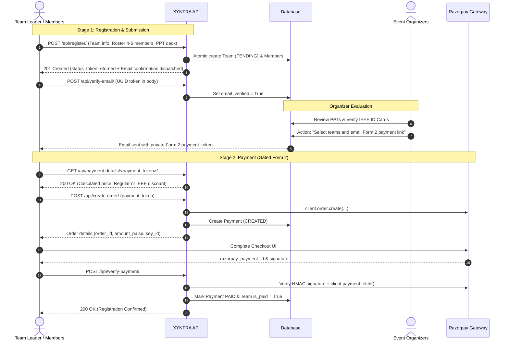

# XYNTRA — Hackathon Registration & Payment Platform

Production-ready backend API service for **XYNTRA** hackathons, symposiums, and competitive tech events. Built with **Django 5**, **Django REST conventions**, and **Razorpay**, providing a secure two-stage submission and payment pipeline with cryptographic verification and IEEE credential validation.

---

## Table of Contents

- [System Architecture](#system-architecture)
- [Directory Layout](#directory-layout)
- [Two-Stage Workflow](#two-stage-workflow)
- [Security Features](#security-features)
- [Getting Started](#getting-started)
- [Environment Variables](#environment-variables)
- [API Reference](#api-reference)
- [Organizer Admin Guide](#organizer-admin-guide)
- [Running Automated Tests](#running-automated-tests)
- [Production Deployment](#production-deployment)

---

## System Architecture

```text
               +-------------------------------------------------------+
               |                  XYNTRA Architecture                   |
               +-------------------------------------------------------+

       [ Client / Frontend ]
                |
                v
       +-----------------+     /api/countdown/
       |   Public API    |---> /api/register/           (Stage 1: Form 1 + PPT)
       |   Endpoints     |---> /api/verify-email/       (Email token confirmation)
       |                 |---> /api/registration-status (Opaque UUID lookup)
       +--------+--------+
                |
                v
       +-----------------+     /api/payment-details/<token>/
       | Gated Form 2 &  |---> /api/create-order/       (Razorpay Order API)
       | Payment API     |---> /api/verify-payment/     (HMAC verification + reconciliation)
       +--------+--------+
                |
                v
       +-------------------------------------------------------+
       |               Business & Services Layer               |
       |  - events.services.razorpay (Order, Verify, Reconcile)|
       |  - events.services.emails   (Transactional SMTP)      |
       +-------------------------------------------------------+
                |
                v
       +-------------------------------------------------------+
       |               Data Layer (Django ORM)                 |
       |  - Event (Active switch, Single-active constraint)    |
       |  - Team (Selection status, Token lifecycle)           |
       |  - TeamMember (IEEE claims & admin verification)      |
       |  - Payment (Razorpay audit, Idempotent states)        |
       +-------------------------------------------------------+
```

---

## Directory Layout

The project follows a clean, modular architecture separating controllers, domain models, services, and tests:

```text
XYNTRA NEW/
├── .env.example              # Documented environment variable template
├── .gitignore                # Production gitignore (excluding media, cache, db, secrets)
├── Procfile                  # Process manager entrypoint for Gunicorn
├── README.md                 # Complete system documentation
├── build.sh                  # Render build script (pip install, collectstatic, migrate)
├── manage.py                 # Django management CLI entrypoint
├── render.yaml               # Infrastructure-as-Code specification for Render
├── requirements.txt          # Python dependencies
│
├── media/                    # Local storage for user uploads (gitignored, kept via .gitkeep)
│   ├── ieee_cards/           # Partitioned IEEE ID card uploads
│   └── ppts/                 # Partitioned presentation deck uploads (.ppt, .pptx, .pdf)
│
├── xyntra/                   # Core Django project configuration
│   ├── __init__.py
│   ├── asgi.py               # ASGI application entrypoint
│   ├── settings.py           # Production-hardened Django settings
│   ├── urls.py               # Root URL router
│   └── wsgi.py               # WSGI application entrypoint
│
└── events/                   # Main hackathon application domain
    ├── __init__.py
    ├── admin.py              # Django admin panel configuration & bulk actions
    ├── apps.py               # Application configuration
    ├── middleware.py         # RatelimitMiddleware translating throttled requests to JSON 429
    ├── urls.py               # API route definitions
    ├── utils.py              # Backward-compatible proxy to events.services
    │
    ├── management/           # Django management commands
    │   └── commands/
    │       └── seed_event.py # Idempotent command to seed or update sample event
    │
    ├── migrations/           # Database schema migrations
    │   ├── 0001_initial.py
    │   ├── 0002_add_ci_team_name_constraint.py
    │   └── 0003_security_hardening.py
    │
    ├── models/               # Modular domain models
    │   ├── __init__.py       # Package entry point (re-exports all models & helpers)
    │   ├── event.py          # Event model, countdown properties, price constraints
    │   ├── team.py           # Team and TeamMember models with IEEE validation
    │   ├── payment.py        # Payment model and status choices
    │   └── validators.py     # Magic-byte file validators & upload path generators
    │
    ├── services/             # Dedicated business logic and third-party integrations
    │   ├── __init__.py       # Package entry point (re-exports service functions)
    │   ├── emails.py         # Transactional email notifications
    │   └── razorpay.py       # Razorpay client, order creation, reconciliation & webhook verification
    │
    ├── views/                # Modular request handlers
    │   ├── __init__.py       # Package entry point (re-exports all views)
    │   ├── countdown.py      # Event countdown & metadata endpoint
    │   ├── registration.py   # Stage 1 team registration view (Form 1, rate-limited)
    │   ├── verification.py   # Email verification view (POST with token expiry, rate-limited)
    │   ├── payment.py        # Stage 2 payment preflight, order creation & verification (rate-limited)
    │   ├── webhook.py        # Authoritative Razorpay webhook handler (payment.captured / order.paid)
    │   ├── status.py         # Privacy-preserving registration status lookup
    │   └── validators.py     # Request bounds & JSON payload validators
    │
    └── tests/                # Modular test suite with sandboxed media storage
        ├── __init__.py       # Package entry point
        ├── base.py           # BaseTestCase with isolated temporary MEDIA_ROOT
        ├── test_admin.py     # Admin action tests (selection, rejection, IEEE verification)
        ├── test_models.py    # Model validation, constraints, and magic-byte tests
        ├── test_payments.py  # Razorpay order, verification, and reconciliation tests
        ├── test_security.py  # Rate limiting (429 responses), token expiration, and bounds tests
        ├── test_views.py     # View tests (countdown, registration, email verify, status)
        └── test_webhook.py   # Webhook signature verification, idempotency, and reconciliation tests
```

---

## Two-Stage Workflow



---

## Security Features

1. **Anti-IDOR / BOLA Protection**: Registration status is queried strictly via an unguessable UUID `status_token` distributed exclusively to the team leader. Arbitrary email lookups are disabled to prevent enumeration.
2. **Authoritative Payment Reconciliation**: Payment verification does not rely on client-provided signatures alone; it initiates a server-to-server inquiry with Razorpay to verify that the transaction is `captured`, belongs to the correct `order_id`, and matches the expected amount and currency.
3. **Razorpay Webhook Safety Net**: Dedicated webhook endpoint (`/api/webhook/razorpay/`) with cryptographic HMAC-SHA256 signature verification guarantees payment reconciliation if a participant's browser disconnects or crashes prior to callback execution.
4. **Endpoint Rate Limiting & Throttling**: Protected with `django-ratelimit` (`register`: 5/m, `create-order`: 5/m, `verify-payment`: 10/m, `verify-email`: 10/m) and handled via custom `RatelimitMiddleware` returning RFC-compliant JSON `429 Too Many Requests` responses.
5. **Magic-Byte File Verification**: Uploaded presentation decks and IEEE ID cards are validated by reading initial magic bytes (PDF, PPTX, PPT, JPEG, PNG), preventing malicious file uploads with spoofed extensions.
6. **Race Condition Prevention**: Database transactions utilize `select_for_update()` to serialize registration and checkout flows, preventing duplicate registrations or concurrent order creation.
7. **Token Expiration**: Email verification tokens expire after 24 hours; payment links expire after 7 days by default.
8. **Request & Body Size Hard Caps**: Enforces a 40 MB total request limit and a 64 KB JSON member payload limit to prevent resource exhaustion attacks.
9. **Automated Rollback Hygiene**: If a transaction fails mid-registration, all uploaded files associated with the rolled-back record are automatically purged from storage.

---

## Getting Started

### Prerequisites

- Python 3.11+
- Virtualenv or venv
- SQLite (for local development) or PostgreSQL (for production)

### 1. Clone & Set Up Virtual Environment

```bash
# Navigate to project root
cd "XYNTRA NEW"

# Create virtual environment
python -m venv .venv

# Activate virtual environment
# Windows (PowerShell):
.venv\Scripts\Activate.ps1
# Linux / macOS:
source .venv/bin/activate
```

### 2. Install Dependencies

```bash
pip install -r requirements.txt
```

### 3. Configure Environment Variables

Create a local `.env` file based on `.env.example`:

```bash
cp .env.example .env
```

Edit `.env` to supply your configuration (see [Environment Variables](#environment-variables)).

### 4. Run Migrations & Seed Sample Event

```bash
# Apply database migrations
python manage.py migrate

# Seed active sample hackathon event
python manage.py seed_event
```

### 5. Create a Superuser

```bash
python manage.py createsuperuser
```

### 6. Start Development Server

```bash
python manage.py runserver
```

The server will start at `http://127.0.0.1:8000/`.

---

## Environment Variables

| Variable | Required | Default | Description |
|---|---|---|---|
| `SECRET_KEY` | **Yes** | — | Cryptographic secret key for Django sessions and tokens. |
| `DEBUG` | No | `False` | Enable debug mode (set to `True` for local development only). |
| `ALLOWED_HOSTS` | No | `localhost,127.0.0.1` | Comma-separated list of allowed host header domains. |
| `FRONTEND_URL` | No | `http://localhost:5173` | Target URL of the Vite frontend for CORS and email links. Set this to the deployed frontend origin in production. |
| `DATABASE_URL` | No | SQLite | PostgreSQL connection URL (e.g., on Render). Defaults to local SQLite if omitted. |
| `RAZORPAY_KEY_ID` | **Yes** | — | Razorpay API key ID (`rzp_test_...` or `rzp_live_...`). |
| `RAZORPAY_KEY_SECRET` | **Yes** | — | Razorpay API secret key. |
| `RAZORPAY_WEBHOOK_SECRET` | Recommended | — | Secret passphrase to verify incoming Razorpay webhooks. |
| `EMAIL_BACKEND` | No | Console | `django.core.mail.backends.console.EmailBackend` for dev or `smtp.EmailBackend` for prod. |
| `EMAIL_HOST` | No | `smtp.gmail.com` | SMTP host server. |
| `EMAIL_PORT` | No | `587` | SMTP port. |
| `EMAIL_USE_TLS` | No | `True` | Use TLS encryption for SMTP. |
| `EMAIL_HOST_USER` | No | — | SMTP username / address. |
| `EMAIL_HOST_PASSWORD` | No | — | SMTP application-specific password. |
| `DEFAULT_FROM_EMAIL` | No | `noreply@xyntra.com`| Sender address on outgoing notification emails. |

---

## API Reference

All API routes are prefixed under `/api/`.

### 1. Countdown & Event Info
- **URL**: `/api/countdown/`
- **Method**: `GET`
- **Response**:
  ```json
  {
    "event_id": 1,
    "title": "XYNTRA 2026",
    "description": "National Inter-College Hackathon",
    "event_date": "2026-10-23T12:00:00+00:00",
    "registration_deadline": "2026-10-08T12:00:00+00:00",
    "venue": "Campus Main Auditorium",
    "regular_price": "2000.00",
    "ieee_price": "1500.00",
    "is_registration_open": true,
    "seconds_remaining": 2592000,
    "countdown": {
      "total_seconds": 2592000,
      "days": 30,
      "hours": 0,
      "minutes": 0,
      "seconds": 0
    }
  }
  ```

### 2. Team Registration (Form 1)
- **URL**: `/api/register/`
- **Method**: `POST` (multipart/form-data)
- **Form Fields**:
  - `team_name`: String (max 150 chars)
  - `leader_email`: String (email)
  - `leader_phone`: String (phone)
  - `ppt_file`: File (`.ppt`, `.pptx`, or `.pdf`, max 10 MB)
  - `members`: JSON string containing 4 to 6 member records:
    ```json
    [
      {
        "full_name": "Alice Smith",
        "email": "alice@univ.edu",
        "phone": "9876543210",
        "college": "Tech Institute",
        "ieee_member": true,
        "ieee_membership_id": "IEEE-987654"
      },
      ...
    ]
    ```
  - `ieee_card_<index>`: File upload for IEEE members (`.jpg`, `.png`, or `.pdf`, max 5 MB)
- **Response**: `201 Created`
  ```json
  {
    "message": "Team registration and presentation deck submitted successfully...",
    "team_id": 12,
    "team_name": "DevTitans",
    "member_count": 4,
    "selection_status": "pending",
    "email_verified": false,
    "status_token": "a1b2c3d4-e5f6-7890-abcd-ef1234567890",
    "confirmation_email_sent": true
  }
  ```

### 3. Email Verification
- **URL**: `/api/verify-email/`
- **Method**: `POST` (`application/json`)
- **Payload**:
  ```json
  {
    "token": "4a7b9c1d-2e3f-4a5b-6c7d-8e9f0a1b2c3d"
  }
  ```
- **Response**: `200 OK`
  ```json
  {
    "message": "Email verified successfully! Your application is currently under PPT evaluation.",
    "team_name": "DevTitans",
    "email_verified": true
  }
  ```

### 4. Gated Payment Details (Form 2 Pre-flight)
- **URL**: `/api/payment-details/<uuid:payment_token>/`
- **Method**: `GET`
- **Response**: `200 OK` (Only accessible if team is `selected`)
  ```json
  {
    "team_id": 12,
    "team_name": "DevTitans",
    "event_title": "XYNTRA 2026",
    "selection_status": "selected",
    "email_verified": true,
    "is_paid": false,
    "qualifies_for_ieee_discount": true,
    "pricing_tier": "ieee_discount",
    "amount_inr": "1500.00",
    "amount_paise": 150000,
    "razorpay_key_id": "rzp_test_..."
  }
  ```

### 5. Create Razorpay Order
- **URL**: `/api/create-order/`
- **Method**: `POST` (`application/json`)
- **Payload**:
  ```json
  {
    "payment_token": "9f8e7d6c-5b4a-3f2e-1d0c-ba9876543210"
  }
  ```
- **Response**: `200 OK`
  ```json
  {
    "order_id": "order_NXg9Y5qAbCdEfG",
    "amount_inr": "1500.00",
    "amount_paise": 150000,
    "currency": "INR",
    "key_id": "rzp_test_...",
    "team_name": "DevTitans",
    "pricing_tier": "ieee_discount",
    "has_ieee_discount": true
  }
  ```

### 6. Verify Payment & Confirm Registration
- **URL**: `/api/verify-payment/`
- **Method**: `POST` (`application/json`)
- **Payload**:
  ```json
  {
    "razorpay_order_id": "order_NXg9Y5qAbCdEfG",
    "razorpay_payment_id": "pay_NXgA1234567890",
    "razorpay_signature": "e5b8...hmac_sha256..."
  }
  ```
- **Response**: `200 OK`
  ```json
  {
    "message": "Payment verified and registration confirmed successfully!",
    "team_name": "DevTitans",
    "leader_email": "leader@univ.edu",
    "is_paid": true,
    "amount_paid": "1500.00",
    "payment_id": "pay_NXgA1234567890"
  }
  ```

### 7. Registration Status Inquiry
- **URL**: `/api/registration-status/?status_token=<uuid>`
- **Method**: `GET`
- **Response**: `200 OK`
  ```json
  {
    "team_name": "DevTitans",
    "event_title": "XYNTRA 2026",
    "leader_email": "leader@univ.edu",
    "selection_status": "selected",
    "email_verified": true,
    "is_paid": true,
    "member_count": 4
  }
  ```

### 8. Razorpay Webhook (Server-to-Server)
- **URL**: `/api/webhook/razorpay/`
- **Method**: `POST` (`application/json`)
- **Headers**:
  - `X-Razorpay-Signature`: HMAC-SHA256 signature generated with `RAZORPAY_WEBHOOK_SECRET`
- **Supported Events**:
  - `payment.captured` / `order.paid`: Authoritatively marks payment `PAID` and `Team.is_paid = True`.
  - `payment.failed`: Marks payment `FAILED`.
  - Other events: Acknowledged with `200 OK` (ignored).
- **Response**: `200 OK`
  ```json
  {
    "status": "success",
    "event": "payment.captured",
    "order_id": "order_NXg9Y5qAbCdEfG",
    "team_name": "DevTitans",
    "is_paid": true
  }
  ```

---

## Organizer Admin Guide

The Django Admin interface is accessible at `/admin/`.

### Key Admin Actions

1. **Reviewing Presentations**:
   - Navigate to **Events > Teams**.
   - Click on any team to view their details and download their uploaded PPT/PDF deck.
2. **Verifying IEEE Membership Credentials**:
   - In the Team page inline roster, click to inspect uploaded IEEE ID cards.
   - Select members in **Events > Team Members** and execute the action **✓ Verify IEEE credentials for selected members**.
   - Note: 100% of team members must be verified for the team to receive the discounted IEEE registration tier.
3. **Selecting Teams & Sending Form 2 Payment Links**:
   - Select candidate teams in **Events > Teams**.
   - Choose the action **★ Select teams and email Form 2 payment link**.
   - This sets `selection_status = 'selected'`, configures a 7-day payment window, and queues the email containing their private payment token.
4. **Rejecting Teams**:
   - Select teams and choose **Mark teams as REJECTED**.

---

## Running Automated Tests

The test suite is modularized under `events/tests/` and automatically isolates media uploads to temporary directories:

```bash
# Run all test suites with verbose output
python manage.py test events -v2

# Run specific test modules
python manage.py test events.tests.test_models
python manage.py test events.tests.test_views
python manage.py test events.tests.test_payments
python manage.py test events.tests.test_webhook
python manage.py test events.tests.test_security
python manage.py test events.tests.test_admin
```

All 64 automated tests verify model constraints, magic-byte checks, payment reconciliation, webhooks, rate limiting, race conditions, and admin workflows.

---

## Production Deployment

The project is pre-configured for deployment on **Render** via `render.yaml`:

- **Web Service**: Python environment managed by Gunicorn (`Procfile`).
- **Database**: Managed PostgreSQL database attached via `DATABASE_URL`.
- **Static Files**: Auto-collected to `staticfiles/` and served via **WhiteNoise**.
- **Build Hook**: Executes `./build.sh` (`pip install -r requirements.txt`, `collectstatic`, `migrate`).

Ensure all required production environment variables (`SECRET_KEY`, `RAZORPAY_KEY_ID`, `RAZORPAY_KEY_SECRET`, `FRONTEND_URL`) are configured in your deployment settings.
